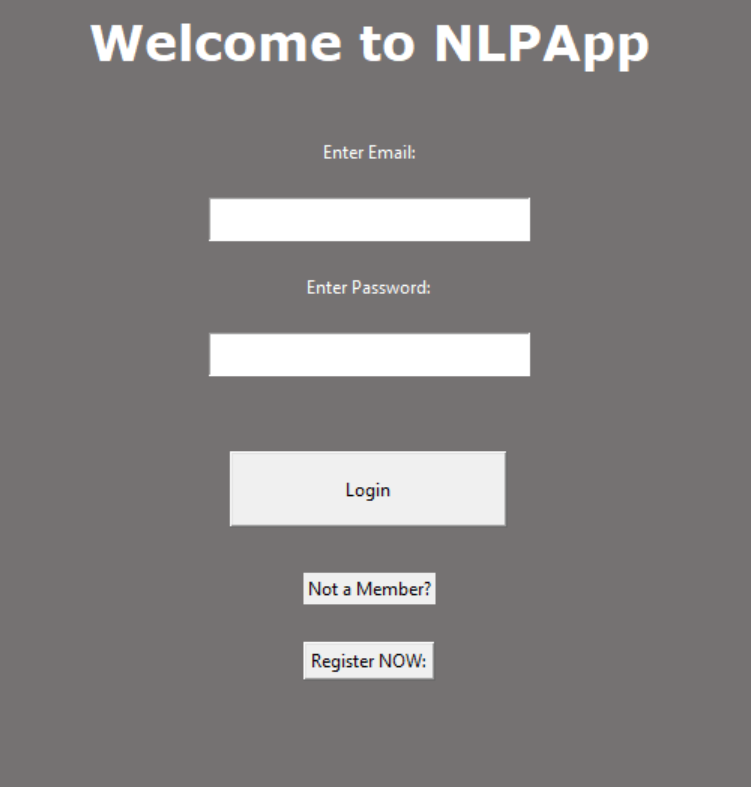
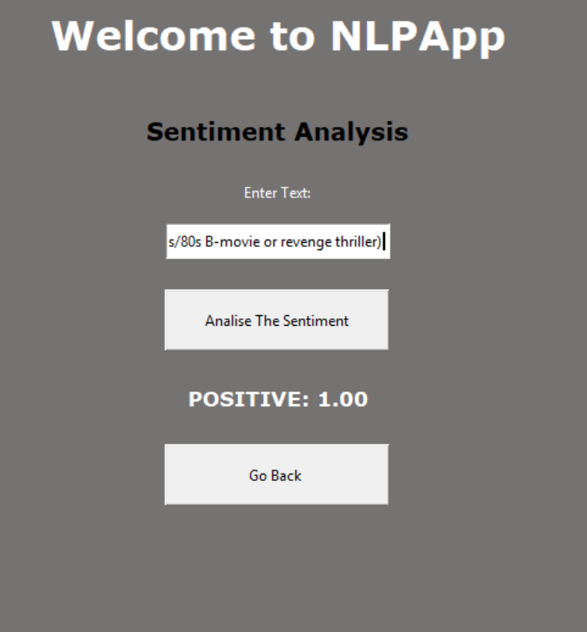
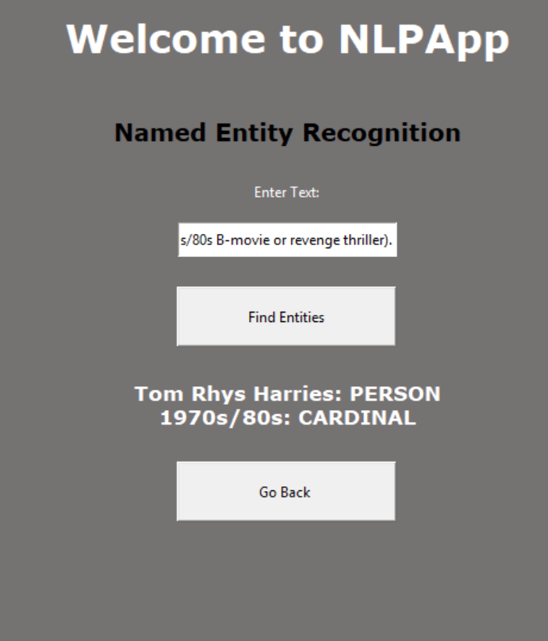
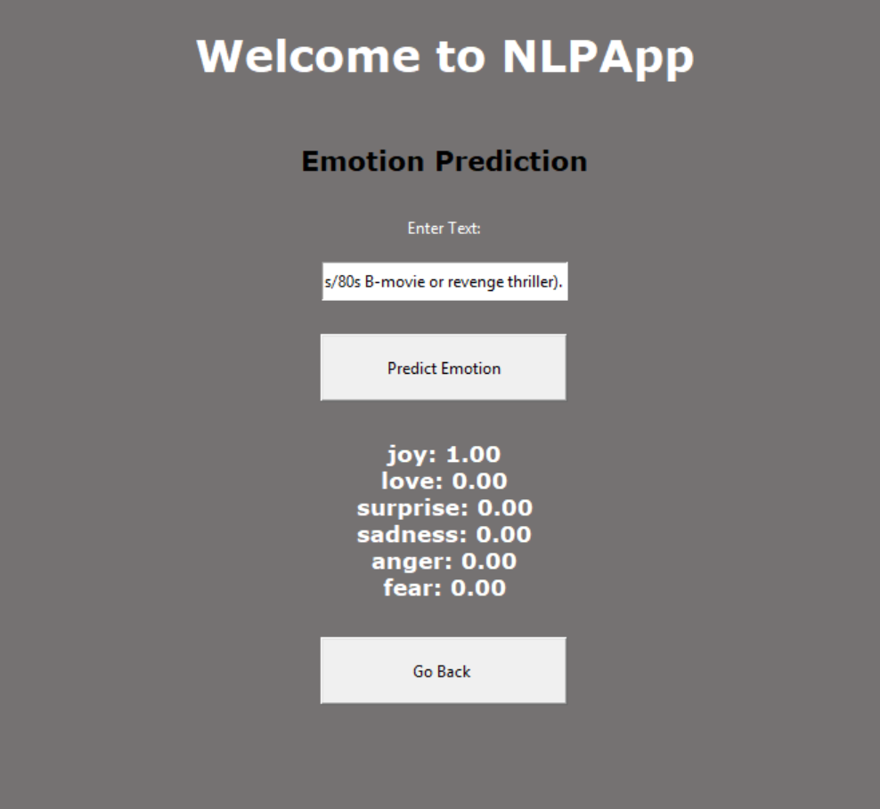

# NLP App


A desktop application built with Python and Tkinter that combines secure user login with three NLP tools: **sentiment analysis**, **named entity recognition** and **emotion prediction**, powered by the [NLP Cloud](https://nlpcloud.com) API.

## Features

- **User accounts:** register and log in, with passwords stored as salted PBKDF2-SHA256 hashes
- **Sentiment analysis:** returns every label with its confidence score
- **Named entity recognition:** detects people, places, dates, organizations and more
- **Emotion prediction:** scores text across multiple emotions
- **Error handling:** empty input and API failures show a message instead of crashing

## Screenshots

<p align="center">
  
  
</p>
<p align="center">
  
  
</p>

## Tech Stack

- **Language:** Python
- **GUI:** Tkinter
- **NLP:** NLP Cloud API (`nlpcloud` client)
- **Storage:** JSON file
- **Config:** `python-dotenv`

## Project Structure

```
NLP-gui/
├── nlpapp.py          # GUI and application flow
├── myapi.py           # NLP Cloud API wrapper
├── mydb.py            # User storage and password hashing
├── resources/         # App icon
├── screenshots/       # README images
├── requirements.txt   # Python dependencies
├── .env.example       # Template for your API key
└── .gitignore
```

## Getting Started

### Prerequisites

- Python 3.8 or newer
- A free API key from [NLP Cloud](https://nlpcloud.com)

### Installation

1. Clone the repository:
   ```
   git clone https://github.com/KrrishTiwari/NLP-gui.git
   cd NLP-gui
   ```

2. Create and activate a virtual environment:
   ```
   python -m venv .venv
   .venv\Scripts\activate
   ```

3. Install the dependencies:
   ```
   pip install -r requirements.txt
   ```

4. Copy `.env.example` to `.env` and add your key:
   ```
   NLPCLOUD_API_KEY=your_api_key_here
   ```

5. Run the app:
   ```
   python nlpapp.py
   ```

## Usage

1. Register a new account, then log in.
2. Choose a tool from the home screen.
3. Enter some text and click the action button to see the results.

## Security Notes

- Passwords are never stored in plain text. Each one is salted and hashed with PBKDF2-HMAC-SHA256.
- The API key is read from a `.env` file, which is excluded from version control.
- `db.json` is created locally on first run and is also excluded from version control.
- This is a learning project. A production system would use a proper database.

## Roadmap

- [ ] Replace JSON storage with SQLite
- [ ] Multi-line text input
- [ ] Loading indicator during API calls
- [ ] Unit tests for the database and API layers

## Author

**Krrish** 
